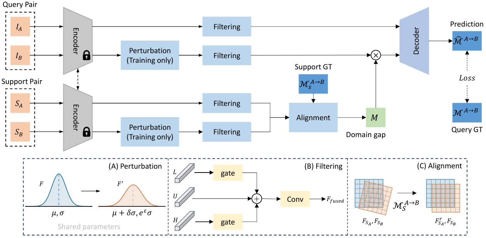

# Support-Guided Feature Alignment for One-Shot Cross-Modal Retinal Dense Matching

Retinal imaging modalities provide complementary views of the same anatomy, but appearance differences and scarce paired annotations complicate cross-modal registration. Motivated by cross-domain few-shot segmentation, we propose a one-shot dense matcher for retinal images that learns from single-modality data but performs inference on unseen modality combinations using a single annotated support pair. Our framework combines support-guided alignment to project features into a comparable space, feature perturbation to simulate domain shifts during single-modality training, and frequency filtering to suppress less informative signals. Across three cross-modal retinal datasets, our method achieves the best results on all six evaluated metrics, reducing mean landmark error by 11.24, 0.14, and 1.01 pixels, respectively, relative to the second-best method on each dataset. Therefore, our work shows how a single annotated pair can guide dense registration across modalities and extends the few-shot concept from segmentation to registration.

[](Network.pdf)

## Installation

Run from the repository root with `uv` installed:

```bash
uv venv --python 3.12
source .venv/bin/activate
uv pip install torch torchvision torchaudio --index-url https://download.pytorch.org/whl/cu128
uv pip install -r requirements.txt
uv sync --extra fused-local-corr

python -c "import torch; print('PyTorch:', torch.__version__); print('CUDA available:', torch.cuda.is_available())"
```

## Data preparation

Set `DATA_ROOT` to the directory containing the retinal datasets:

```bash
export DATA_ROOT=/path/to/Retina
```

## Training

Train the default variants on FIRE:

```bash
bash script/train_roma_fewshot_retina.sh
```

## Evaluation

Evaluate on OCTA, MISP, and FA-SLO. Keep `GROUP`, `CROSS_TRAIN`, `CKPT_DIR`, `TRAIN_RESOLUTION`, and `ALIGN_SCALES` consistent with training:

```bash
bash script/test_roma_fewshot_retina.sh
```

## Ablation variants

Variants are defined in [experiments/utils/variants.py](experiments/utils/variants.py).

| Variant | Fine-tuning | Support alignment | Training perturbation | Frequency modulation |
| --- | --- | --- | --- | --- |
| `zero` | No | No | No | No |
| `baseline` | Yes | No | No | No |
| `few_shot` | Yes | Yes | No | No |
| `few_shot+perturb` | Yes | Yes | Yes | No |
| `few_shot+freq` | Yes | Yes | No | Yes |
| `few_shot+perturb+freq` | Yes | Yes | Yes | Yes |
| `gamma0+perturb` | Yes | No | Yes | No |
| `gamma0+freq` | Yes | No | No | Yes |
| `gamma0+perturb+freq` | Yes | No | Yes | Yes |

The `gamma0` variants disable the support residual. Use the same variant and alignment scales for training and evaluation. Evaluation disables perturbation by default.

## Acknowledgments and license

Built on [RoMa](https://github.com/Parskatt/RoMa). Please cite the upstream work when using these models in research.

Released under the [MIT license](LICENSE), retaining the upstream copyright notice. Dependencies, pretrained weights, and datasets follow their respective licenses.
